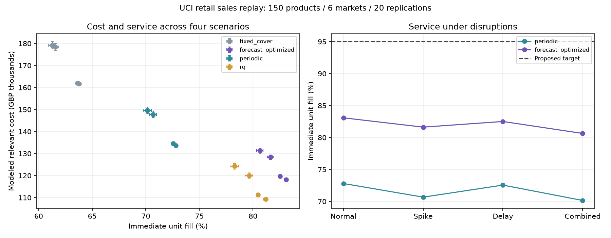

# Inventory Decision Intelligence

**A company-style replenishment decision system built on real retail transactions.**

[](https://colab.research.google.com/github/buckminster07/multi-echelon-inventory-optimization/blob/main/notebooks/02_real_retail_planning.ipynb)
[](https://github.com/buckminster07/multi-echelon-inventory-optimization/actions/workflows/ci.yml)

An online retailer needs to decide how much to replenish, where to position stock, and which orders a planner should approve under uncertain demand and supplier delays. This project turns that brief into a reproducible Python/SQL pipeline, constrained network simulator and auditable planner interface.

**150 products · 6 markets · 597 active product–market pairs · 4 policies · 4 scenarios · 320 held-out simulation trials.**

[Business brief](docs/RETAIL_BUSINESS_BRIEF.md) · [Dataset](docs/RETAIL_DATA_CARD.md) · [Methods](docs/RETAIL_METHODS.md) · [Results](examples/retail/RESULTS.md) · [Learn and explain](docs/RETAIL_LEARNING_PATH.md) · [Validation](docs/RETAIL_VALIDATION.md)

## Run the complete Colab pipeline

Open the badge, choose `PROFILE = "quick"` for a smaller first run or `"full"` for the published experiment, and run all cells. Twelve stages expose data preparation, SQL integration, forecast training, uncertainty calibration, policy tuning, stress tests, planner widgets and downloadable reports, CSVs and an audit database. The planner supports approval, rejection, valid quantity reductions and replay. It does not transmit supplier orders.

```bash
python -m pip install -r retail_requirements.txt
python run_retail.py --profile quick --output outputs/my-first-run
python run_retail.py --profile full --output outputs/my-full-run
```

Use a fresh output directory for each run to protect existing decisions. The initial download is approximately 46 MB. The original cached inventory benchmark took about 133 seconds on the development machine; extended EDA adds a scan of both workbook sheets. Colab timing varies.

## Dataset and business assumptions

[UCI Online Retail II](https://archive.ics.uci.edu/dataset/502/online+retail+ii), contributed by Daqing Chen, contains 1,067,371 transaction rows from a UK online retailer across 2009–2011. Actual quantities, prices, cancellations and country variation make it useful for studying intermittent demand and bulk purchases. Dataset license: CC BY 4.0; [DOI](https://doi.org/10.24432/C5CG6D).

The training-only cohort selects United Kingdom, EIRE, Netherlands, Germany, France and Australia. Modeling excludes customer identifiers. The extended EDA reads their completeness transiently and exports only aggregate missingness counts. The data card documents cleaning and the source checksum.

The source does not contain warehouse inventory or supplier lead times. A central warehouse plus six market hubs is a proposed network. Lead times, costs, capacity and budgets are explicit assumptions. Historical sales are a demand proxy; demand-uplift sensitivity examines possible unobserved demand.

## Executed findings

Normal-scenario averages over 20 paired replications on October–November 2011:

| Policy | Immediate unit fill | Modeled relevant cost GBP |
|---|---:|---:|
| Fixed cover | 63.77% | 161,672 |
| Reorder point / order quantity | 81.19% | 109,225 |
| Periodic review | 72.80% | 133,675 |
| Forecast-based constrained targets | 83.08% | 118,239 |

The forecast-based policy improves service over periodic review by 10.28 percentage points and reduces modeled cost by about 11.5%. Reorder-point replenishment costs less and holds less inventory. Neither achieves the proposed 95% target. Investigate bulk-order promises, lead times and resource constraints before rollout.

Per-series forecast selection achieves test WAPE of 106.2%, versus 107.6% for moving averages and 114.9% for global boosting. Errors remain large: machine learning does not automatically improve this intermittent, wholesale-like demand. Unsuccessful service targets and weak forecasts remain visible in the evidence.



These are simulated outcomes against real sales, not verified company savings. Relevant costs include holding, ordering, internal freight and assumed lost margin. Procurement cash and ending inventory value are separate exports. Confidence intervals condition on observed history and modeled randomness.

## Design and controls

### Extended EDA with charts

The Colab notebook starts with an original-data preview and column guide, then walks through EDA in sections 2.1–2.12. Each topic has its own calculation cell, table and chart before SQL integration and forecasting. The CLI and Colab notebook include [executed EDA findings and five figures](examples/retail/eda/README.md):

- Full original-column missing-value counts by workbook sheet and overall, with a completeness chart.
- A training-period daily trend, detrended weekday profile, Friedman weekday-effect test with effect size, and complete-month sales chart. Annual seasonality is not established by this short training history.
- Within-product-market monthly median selling-price changes, with a change histogram and indexed price trajectories.
- Market-level returned-to-gross unit ratios, with volume-aware charts and explicit unmatched-return limitations.
- Sensitivity to 1,000, 5,000, 10,000 and unlimited units per invoice line, comparing sales retention and daily spikes.

The notebook displays the charts and tables directly; its download includes the complete `eda/` folder. Behavioral EDA uses training dates only across the eligible source catalog, rather than only the selected benchmark cohort. The published inventory benchmark and 10,000-unit cleaning rule are unchanged.

- SQL tables integrate products, markets, daily sales, assortment, experiments, assumptions, proposals and decisions. SQL joins feed the modeling panel.
- Four forecasts compete: seasonal naive, moving average, TSB and global Poisson gradient boosting. Recursive features use past information only.
- Time windows are separate: training through April 2011, May selection, June–July calibration, August tuning, September validation, October–November test.
- Replenishment enforces packs, MOQ, product/shared storage, a common rolling seven-day budget, central allocation and pending internal requests.
- Comparisons use common random numbers, identical starting stocks, positive transit times and daily conservation/resource assertions.
- Approvals persist actor and reason, validate quantities and support replay; manifests capture data/code hashes, seeds and versions.

## Understand and explain the project

Start with the business brief, execute the notebook, then use the [learning path](docs/RETAIL_LEARNING_PATH.md) for equations, experiments, interview questions and a project explanation. Learn why a forecast is not an inventory policy, why service targets can be infeasible, and why lower cost and higher service may identify different winners.

| Module | Responsibility |
|---|---|
| `retail_planner/data.py` | Verification, cleaning, cohort selection and SQLite |
| `retail_planner/forecast.py` | Baselines, boosting, selection and calibration |
| `retail_planner/simulation.py` | Network flows, constraints, allocation and costs |
| `retail_planner/evaluation.py` | Tuning, replicated evaluation and sensitivity |
| `retail_planner/planner.py` | Approval transactions, widgets and replay |
| `retail_planner/pipeline.py` | Orchestration and exports |
| `retail_planner/report.py` | Charts and HTML report |

The local suite passes **22 tests**, including return denominators, cutoff sensitivity, consecutive-month price comparisons and weekday diagnostics. Notebook Python cells were executed sequentially with the quick real-data profile; the full inventory benchmark ran separately. These local checks do not establish hosted Colab browser rendering.

```bash
python -m pip install -e '.[dev]'
python -m pytest -q
```

Curated results are in `examples/retail/`. Large caches, databases and detailed forecast/shipment exports regenerate through the notebook. The manifest describes the complete generated output set, including files omitted from the curated snapshot.

The earlier synthetic model remains in `src/inventory_lab/`, `notebooks/01_inventory_decisions.ipynb` and `examples/full/`; its results are separate. Code is MIT licensed; source data retains its own license and attribution.
