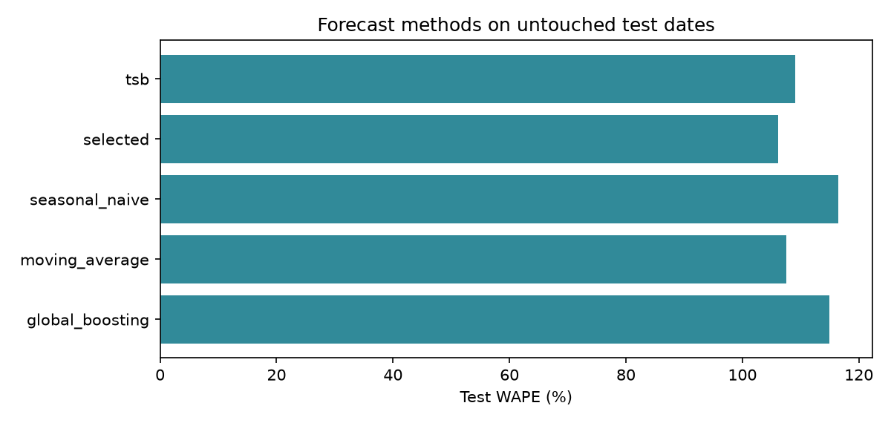

# Real-data retail planning: executed results

Dataset: UCI Online Retail II. Cohort: 150 SKUs, 6 markets, 597 active pairs. Test: 1 October–30 November 2011. 20 replications per policy and scenario.

Sales are observed transactions. Service, shortages, network movements and operating costs are modeled counterfactual outcomes. They are not the retailer’s measured historical inventory performance.

| Scenario | Policy | Relevant cost GBP | Fill % | A-item fill % | Lost units | Average inventory |
|---|---|---:|---:|---:|---:|---:|
| combined | fixed_cover | 179,169 | 61.26 | 61.83 | 109,871 | 68,181 |
| combined | forecast_optimized | 131,287 | 80.64 | 81.41 | 54,918 | 107,479 |
| combined | periodic | 149,626 | 70.15 | 70.99 | 84,662 | 81,584 |
| combined | rq | 124,232 | 78.30 | 78.73 | 61,569 | 89,685 |
| demand_spike | fixed_cover | 178,367 | 61.55 | 62.16 | 109,069 | 71,289 |
| demand_spike | forecast_optimized | 128,420 | 81.63 | 82.60 | 52,120 | 112,082 |
| demand_spike | periodic | 147,788 | 70.67 | 71.63 | 83,199 | 85,008 |
| demand_spike | rq | 120,026 | 79.63 | 80.19 | 57,783 | 93,675 |
| normal | fixed_cover | 161,672 | 63.77 | 64.56 | 96,698 | 72,240 |
| normal | forecast_optimized | 118,239 | 83.08 | 84.16 | 45,158 | 113,314 |
| normal | periodic | 133,675 | 72.80 | 73.89 | 72,595 | 86,307 |
| normal | rq | 109,225 | 81.19 | 81.98 | 50,221 | 95,183 |
| supplier_delay | fixed_cover | 161,954 | 63.63 | 64.38 | 97,087 | 69,270 |
| supplier_delay | forecast_optimized | 119,662 | 82.51 | 83.41 | 46,688 | 109,282 |
| supplier_delay | periodic | 134,521 | 72.55 | 73.58 | 73,262 | 83,009 |
| supplier_delay | rq | 111,304 | 80.46 | 81.10 | 52,148 | 91,499 |

Read paired_differences.csv for adaptive-versus-each-comparator confidence intervals; negative differences favor adaptive. The intervals describe lead-time and selected disruption randomness conditional on the observed sales history. They do not quantify all uncertainty in unobserved demand or assumed costs.

The optimizer selects the cheapest service-feasible tested combination. If no candidate satisfies the proposed aggregate/A-item constraints on tuning scenarios, it selects the least violating candidate and reports the gap in tuning.csv. Combined disruption is excluded from tuning.

Procurement cash, terminal inventory value, constrained orders, per-pair service and sensitivity are separate exports. Cost excludes procurement capital to avoid finite-horizon purchase artifacts; lost-margin cost is an explicit assumption. No usability participants or production deployment are claimed.