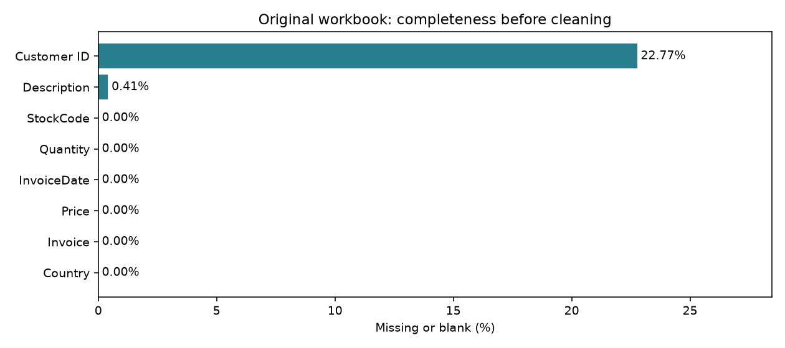
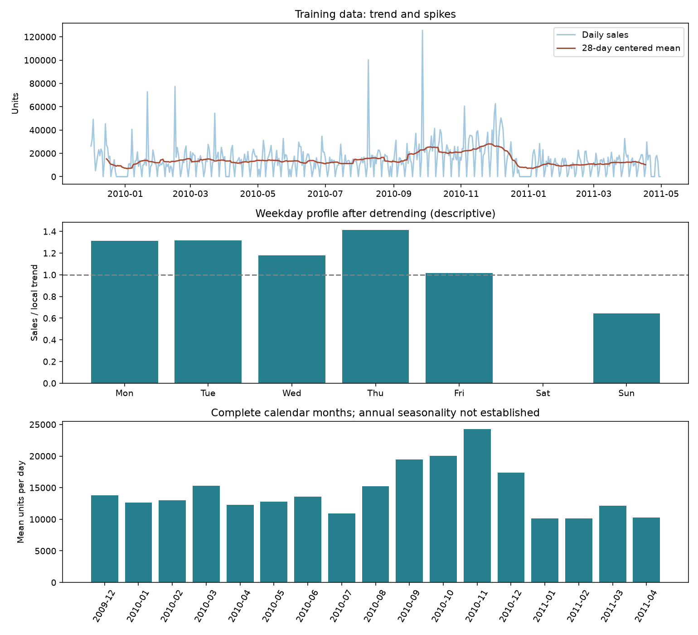
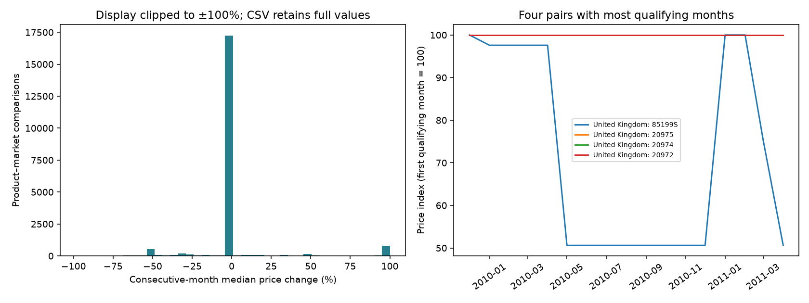
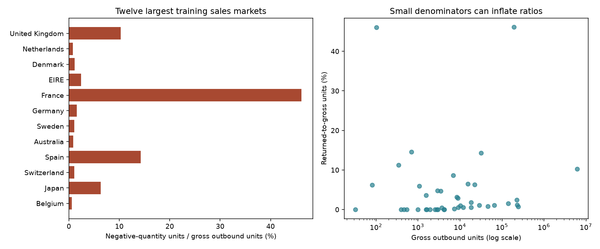
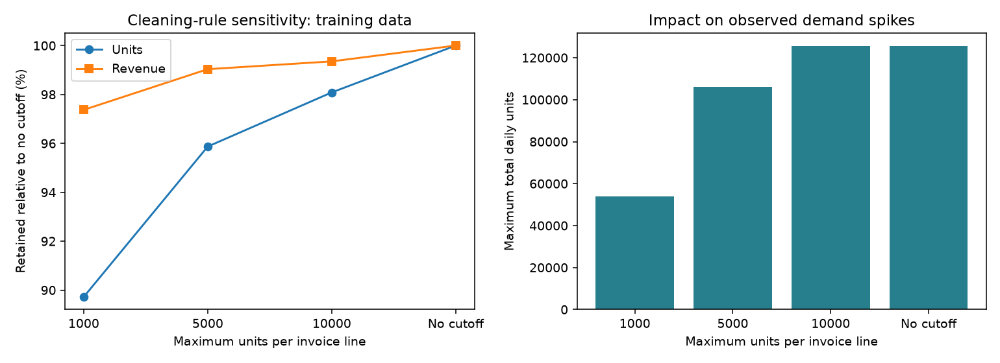

# Extended exploratory data analysis

Missingness covers both original workbook sheets, before cleaning. Customer identifiers are inspected transiently for completeness and immediately discarded; no IDs are exported. All behavioral analyses use only data through 2011-04-30, across all eligible products and markets, not only the 150-product benchmark cohort. They do not tune or change the published replenishment benchmark.

## 1. Missing values
Full per-sheet and overall counts: [missing_values.csv](missing_values.csv). Missing means null or whitespace; sentinel strings and incorrect-but-present values need separate validation. Missing descriptions do not automatically invalidate a product identifier. Missing customer IDs do not prevent product-level inventory analysis.

## 2. Seasonality and trend
The weekday test uses 69 complete weeks after dividing sales by a centered 28-day moving average. Friedman statistic: 209.065; p-value: 2.23e-42; Kendall's W: 0.505. W is an effect-size summary, not a forecasting score. Centered smoothing is descriptive only and never used as a forecast feature. Serial dependence weakens the nominal p-value interpretation; ordering and closure schedules can create weekday effects.

Monthly means normalize for calendar exposure and omit incomplete months. Training history has fewer than two complete annual cycles; this analysis does not establish annual seasonality. Zero recorded sales are not confirmed zero latent demand.

## 3. Price changes
Monthly transaction-line median selling prices are compared within the same product and market, only for consecutive months with at least five valid sales lines each. There are 20,200 qualifying comparisons; 15.82% change by more than 1% in magnitude. Prices can reflect discounts, quantity mix and customer mix; these are not proven list-price changes or causal elasticity estimates. Charts clip the histogram for readability; CSV values remain unmodified.

## 4. Market returns
Negative-quantity product units are divided by gross positive outbound product units in the same training window, before the bulk-order cutoff. Returns are not linked to original purchases; a ratio can exceed 100%, and cancellation records do not establish physical resale recovery. Invalid or nonproduct lines are excluded. Positive cancellation lines are excluded from sales and are not counted as returned units.

## 5. Extreme-order sensitivity
Compare maximum invoice-line quantities of 1,000, 5,000, 10,000 and no cap. The table reports excluded rows, retained units/revenue, maximum daily volume and daily coefficient of variation. This measures data sensitivity, not policy-cost or service sensitivity: no alternative-threshold inventory experiment is claimed. The existing 10,000-unit rule remains unchanged.

For each chart, explain the denominator, time window, business implication and what the data cannot establish. Numerical source tables and `eda_manifest.json` accompany the figures.

The published snapshot includes the full monthly-price table as [monthly_prices.csv.gz](monthly_prices.csv.gz). The notebook generates the uncompressed CSV. The execution manifest records that uncompressed file hash. Data-derived tables retain the UCI source CC BY 4.0 attribution.
